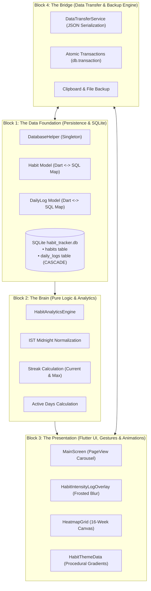

# Habitually — System Architecture & Technical Reference

This document serves as the master engineering reference for **Habitually**, detailing the design decisions, mathematical foundations, data layer, logic engine, and Flutter presentation pipeline.

---

## 🏛️ The 4 Blocks of Habitually



### Overview of the Blocks:
1. **Block 1: The Data Foundation (Persistence & SQLite)**
   - **What it does**: Ensures your device remembers everything permanently across reboots and app kills.
   - **Key concepts**: Relational tables (`habits`, `daily_logs`), foreign keys, cascading deletes, indexes, and Dart Data Models (`toMap()` / `fromMap()`).
   - **Core files**: `lib/database/database_helper.dart`, `lib/models/habit.dart`, `lib/models/daily_log.dart`.

2. **Block 2: The Brain (Pure Logic & Analytics)**
   - **What it does**: Zero UI. Pure mathematical rules and timezone-safe date calculations.
   - **Key concepts**: Current streaks, personal best streaks, active days count, IST midnight calendar day normalization, and grace period logic.
   - **Core file**: `lib/analytics/habit_analytics_engine.dart`.

3. **Block 3: The Presentation (Flutter UI, Gestures & Animations)**
   - **What it does**: Everything the user sees, touches, and feels at smooth 60/120fps.
   - **Key concepts**: `StatefulWidget`, `PageView`, in-tree frosted glass Gaussian blur overlays, fluid liquid wave capsule animations, dynamic color-morphing ambient gradients, and the 16-week Heatmap Grid.
   - **Core files**: `lib/ui/main_screen.dart`, `lib/ui/habit_intensity_log_overlay.dart`.

4. **Block 4: The Bridge (Data Transfer & Backup Engine)**
   - **What it does**: Handles clean data entry and exit without baking personal data into public APK binaries.
   - **Key concepts**: JSON serialization, clipboard integration, and atomic SQLite transactions (`db.transaction` with automatic rollback on error).
   - **Core file**: `lib/database/data_transfer_service.dart`.

---

# 📦 Deep Dive: Block 1 — The Data Foundation

## 1. Why SQLite on Mobile?
Mobile devices have unpredictable lifecycles: the operating system can terminate an app in the background at any moment to reclaim RAM. If habit tracking data is only kept in device memory (`RAM`), everything vanishes the moment the app closes.

**SQLite** is an embedded, serverless, transactional SQL database engine built directly into Android and iOS:
- **Zero Configuration**: No server, no ports, no passwords. The entire database lives in a single local file (`habit_tracker.db`) inside the app's sandboxed private storage.
- **ACID Compliant**: Atomic, Consistent, Isolated, and Durable. If your phone loses battery midway through saving a log, SQLite guarantees the database never corrupts.

---

## 2. Relational Schema Design

Habitually uses a **two-table relational architecture** connected by a foreign key with cascading deletes:

```
┌───────────────────────────────────────┐
│              habits                   │
├───────────────────────────────────────┤
│ id (PK, AUTOINCREMENT)  INTEGER       │ <──────┐
│ name                    TEXT          │        │
│ color_code              TEXT          │        │ 1-to-Many
│ is_archived             INTEGER (0/1) │        │ (Foreign Key)
│ is_paused               INTEGER (0/1) │        │
│ created_at              TEXT          │        │
│ max_streak              INTEGER       │        │
│ active_days             INTEGER       │        │
└───────────────────────────────────────┘        │
                                                 │
┌───────────────────────────────────────┐        │
│            daily_logs                 │        │
├───────────────────────────────────────┤        │
│ id (PK, AUTOINCREMENT)  INTEGER       │        │
│ habit_id                INTEGER       ├────────┘ [ON DELETE CASCADE]
│ log_date                TEXT          │
│ intensity               INTEGER (1-10)│
│ note                    TEXT          │
│ UNIQUE(habit_id, log_date)            │
└───────────────────────────────────────┘
```

### Table 1: `habits`
- `id`: Auto-incrementing unique integer primary key (`1`, `2`, `3`...).
- `name`: User-defined title (e.g. *"Chanting"*).
- `color_code`: 8-character hex string including alpha (`#FFFF7A00`).
- `is_archived`: Integer flag (`0` for active, `1` for archived). SQLite lacks a boolean primitive, so standard convention is `0` (false) and `1` (true).
- `is_paused`: Integer flag (`0` for active tracking, `1` for frozen streak).
- `created_at`: ISO-8601 UTC timestamp string (`"2026-11-04T00:00:00.000Z"`).
- `max_streak`: Cached personal best consecutive-day record.
- `active_days`: Cached total count of unique logged days.

### Table 2: `daily_logs`
- `id`: Auto-incrementing log ID.
- `habit_id`: Relational link to the parent habit.
- `log_date`: Standardized date string (`"YYYY-MM-DD"` in local IST).
- `intensity`: Integer rating (1 to 5 used in the UI, constrained in SQL `CHECK (intensity >= 1 AND intensity <= 10)`).
- `note`: Optional string reflection for that session.
- `UNIQUE(habit_id, log_date)`: Guarantees that a habit can never have duplicate log rows for the same calendar date.
- `FOREIGN KEY (habit_id) REFERENCES habits(id) ON DELETE CASCADE`:
  - **The Power of CASCADE**: When a user deletes a habit from `habits`, SQLite's internal engine automatically deletes every single log row belonging to that habit in `daily_logs`. Zero orphaned records, zero manual cleanup queries needed.

### Indexes for High Performance:
```sql
CREATE INDEX idx_daily_logs_habit_id ON daily_logs (habit_id);
CREATE INDEX idx_daily_logs_date ON daily_logs (log_date);
```
- Without an index, querying 365 days of logs requires a full table scan ($O(N)$).
- With a B-Tree index, SQLite jumps straight to the habit's logs in $O(\log N)$ time, maintaining buttery 120fps UI performance even after years of tracking.

---

## 3. The Data Bridge: Models (`toMap` and `fromMap`)

SQLite understands only 4 native types: `INTEGER`, `TEXT`, `REAL`, `BLOB`. It does not know what a Dart `class Habit`, a `Color`, or a `DateTime` is.

The files `lib/models/habit.dart` and `lib/models/daily_log.dart` provide the translation bridge:

```
[ Dart World (UI / Logic) ]                         [ SQLite World (Disk) ]
Habit Object                                         Table Row
• id: 1                                              • id: 1
• name: "Chanting"            ── toMap() ──>         • name: 'Chanting'
• colorCode: "#FFFF7A00"      <── fromMap() ──       • color_code: '#FFFF7A00'
• isPaused: false                                    • is_paused: 0
• createdAt: DateTime(...)                           • created_at: '2026-11-04...'
```

### Why `toMap()`?
Converts a strongly-typed Dart object into a `Map<String, dynamic>` where keys match SQL column names:
```dart
Map<String, dynamic> toMap() {
  return {
    'name': name,
    'color_code': colorCode,
    'is_archived': isArchived ? 1 : 0,
    'is_paused': isPaused ? 1 : 0,
    'created_at': createdAt.toIso8601String(),
    'max_streak': maxStreak,
    'active_days': activeDays,
  };
}
```

### Why `fromMap()`?
A `factory` constructor that reads raw database row maps and safely reconstructs the Dart object:
```dart
factory Habit.fromMap(Map<String, dynamic> map) {
  return Habit(
    id: map['id'] as int?,
    name: map['name'] as String,
    colorCode: map['color_code'] as String,
    isArchived: (map['is_archived'] as int?) == 1,
    isPaused: (map['is_paused'] as int?) == 1,
    createdAt: DateTime.parse(map['created_at'] as String),
    maxStreak: (map['max_streak'] as int?) ?? 0,
    activeDays: (map['active_days'] as int?) ?? 0,
  );
}
```

---

## 4. Master Engine: `DatabaseHelper`

Located at [`lib/database/database_helper.dart`](file:///c:/Users/Shiva%20The%20%20Legend/OneDrive/Desktop/Habit%20Tracker/lib/database/database_helper.dart), this class is the single gatekeeper for all disk I/O.

### A. The Singleton Pattern
```dart
DatabaseHelper._init();
static final DatabaseHelper instance = DatabaseHelper._init();
```
- **Why?**: On mobile operating systems, opening multiple simultaneous connection pools to the same SQLite file causes database lock collisions (`database is locked`).
- By keeping the constructor private (`._init()`), no code can instantiate new helpers. Everyone accesses `DatabaseHelper.instance`.

### B. Foreign Key Enforcement
```dart
Future<void> _onConfigure(Database db) async {
  await db.execute('PRAGMA foreign_keys = ON;');
}
```
- By default, SQLite disables foreign key checks for legacy backwards compatibility. Turning this on at configuration time guarantees that `ON DELETE CASCADE` is physically enforced by the SQLite C-engine.

### C. Function-by-Function Breakdown

| Function | What it does | Who calls it? | Real-World Scenario |
| :--- | :--- | :--- | :--- |
| `insertHabit(Habit)` | Inserts habit into `habits` table. Returns auto-generated `int id`. | `_showAddHabitSheet` in `MainScreen` | User types habit name, picks color, taps "Create Habit". |
| `fetchActiveHabits()` | `SELECT * WHERE is_archived = 0 ORDER BY id ASC` | `_initDatabaseAndLoadHabits` in `MainScreen` | App launches or restarts; loads all habits for carousel. |
| `updateHabitStats(...)` | Updates `active_days` and `max_streak` on habit row. | `onLogSaved`, `onLogRemoved` in `MainScreen` | User logs or deletes a daily session; habit header stats update immediately. |
| `updateHabitPaused(...)` | Updates `is_paused = 0` or `1`. | Settings sheet / Pause confirmation dialog | User freezes a habit while traveling or ill. |
| `deleteHabit(int id)` | `DELETE FROM habits WHERE id = ?` | Delete habit dialog | User confirms habit deletion. All child logs disappear via CASCADE. |
| `insertLog(DailyLog)` | `INSERT INTO daily_logs ... ON CONFLICT REPLACE` | `onLogSaved` in `MainScreen` | User taps "Log Today", selects intensity 1-5, and taps save. |
| `deleteLog(int, date)` | `DELETE FROM daily_logs WHERE habit_id = ? AND log_date = ?` | `onLogRemoved` in `MainScreen` | User taps "Remove Marking" on an existing logged cell. |
| `fetchLogsForHabit(int)` | Returns all logs for one habit sorted chronologically. | `_initDatabaseAndLoadHabits` in `MainScreen` | Builds the 16-week Heatmap grid and calculates streaks. |
| `clearAllData()` | Wipes all rows from `daily_logs` and `habits`. | "Reset to Clean Slate" in Backup & Restore | User wants to flush the database back to 0 habits. |
| `purgeLegacyMockData()`| Safely removes old prototype mock records. | Startup check | Guarantees test devices running early builds start clean. |


---

## 5. File & Function Dictionary (Block 1 Cheat Sheet)

### 📂 File 1: `lib/models/habit.dart`
- **Location**: [`lib/models/habit.dart`](file:///c:/Users/Shiva%20The%20%20Legend/OneDrive/Desktop/Habit%20Tracker/lib/models/habit.dart)
- **Role**: Dart in-memory representation of one `habits` database row.

| Function / Constructor | What it does | Who calls it? |
| :--- | :--- | :--- |
| `Habit(...)` | Instantiates habit with `id`, `name`, `colorCode`, `isPaused`, `createdAt`, `maxStreak`, `activeDays`. | State, UI, and Database when loading or creating habits. |
| `toMap()` | Converts Dart `Habit` $\rightarrow$ SQL dictionary (`Map<String, dynamic>`) matching table columns. | `insertHabit()` and `updateHabit()`. |
| `fromMap(map)` | Deserializes raw SQLite row map $\rightarrow$ strongly-typed Dart `Habit` object. | `fetchActiveHabits()`. |
| `copyWith(...)` | Clones habit while updating specific attributes immutably. | State handlers when updating properties. |

---

### 📂 File 2: `lib/models/daily_log.dart`
- **Location**: [`lib/models/daily_log.dart`](file:///c:/Users/Shiva%20The%20%20Legend/OneDrive/Desktop/Habit%20Tracker/lib/models/daily_log.dart)
- **Role**: Dart in-memory representation of one check-in entry in `daily_logs`.

| Function / Constructor | What it does | Who calls it? |
| :--- | :--- | :--- |
| `DailyLog(...)` | Instantiates log with `habitId`, `logDate` (`YYYY-MM-DD`), `intensity` (1–10), and optional `note`. | Overlay and UI logging handlers. |
| `toMap()` | Converts Dart `DailyLog` $\rightarrow$ SQL dictionary for SQLite. | `insertLog()`. |
| `fromMap(map)` | Deserializes raw SQLite log row $\rightarrow$ Dart `DailyLog` object. | `fetchLogsForHabit()`. |
| `copyWith(...)` | Clones log while updating specific attributes (e.g. intensity or note). | Overlay slider interactions. |

---

### 📂 File 3: `lib/database/database_helper.dart`
- **Location**: [`lib/database/database_helper.dart`](file:///c:/Users/Shiva%20The%20%20Legend/OneDrive/Desktop/Habit%20Tracker/lib/database/database_helper.dart)
- **Role**: Master gatekeeper for all physical disk I/O on the device.

#### Lifecycle & Setup:
- **`DatabaseHelper._init()` / `instance`**: Singleton pattern. Only 1 connection instance exists across the app, eliminating `database is locked` multi-thread collisions.
- **`get database`**: Lazy getter. Opens and returns the SQLite database connection, initializing FFI on desktop platforms.
- **`_onConfigure(db)`**: Executes `PRAGMA foreign_keys = ON;` to turn on cascading delete checks in the C-engine.
- **`_onCreate(db, version)`**: Runs DDL `CREATE TABLE` and `CREATE INDEX` statements on initial install.
- **`_onUpgrade(db, oldVer, newVer)`**: Migrates schemas across database versions (e.g., adding `is_paused`).

#### Habit Operations:
- **`insertHabit(Habit)`**: Executes `INSERT INTO habits...`. Returns auto-incremented integer ID. (Called by Add Habit Sheet).
- **`fetchActiveHabits()`**: Executes `SELECT * FROM habits WHERE is_archived = 0 ORDER BY id ASC`. (Called by App startup `initState`).
- **`updateHabitStats({habitId, activeDays, maxStreak})`**: Updates cached streaks and active days directly on the habit row. (Called by `onLogSaved` and `onLogRemoved`).
- **`updateHabitPaused(habitId, isPaused)`**: Updates `is_paused` flag in SQLite. (Called by pause/resume buttons).
- **`deleteHabit(int id)`**: Executes `DELETE FROM habits WHERE id = ?`. Foreign key cascades to wipe all child logs in `daily_logs`. (Called by Delete dialog).

#### Daily Log Operations:
- **`insertLog(DailyLog)`**: Executes `INSERT OR REPLACE INTO daily_logs...`. Replaces existing log for that date on conflict. (Called by "Log Intensity").
- **`deleteLog(habitId, logDate)`**: Executes `DELETE FROM daily_logs WHERE habit_id = ? AND log_date = ?`. (Called by "Remove Marking").
- **`fetchLogsForHabit(habitId)`**: Queries all logs for a habit sorted chronologically. (Called to populate the 16-week Heatmap grid).

#### Reset & Maintenance:
- **`clearAllData()`**: Wipes both `daily_logs` and `habits` tables. (Called by "Reset to Clean Slate").
- **`purgeLegacyMockData()`**: Removes prototype test habits (*Chanting*, *Meditation*, *Cold Shower*) from early builds.

---

## 6. The Native Bridge: How Dart Talks to SQLite

```
[ Dart Code in MainScreen / Helper ]
await db.insert('habits', habit.toMap());
                │
                ▼
[ sqflite Flutter Plugin (Dart Layer) ]
Packages method name & SQL arguments into binary
                │
                ▼  (Flutter MethodChannel Bridge)
[ Android Native Framework (Java / Kotlin Layer) ]
Calls android.database.sqlite.SQLiteDatabase
                │
                ▼
[ Android OS Native Kernel (C / C++) ]
Executes within libsqlite.so directly on hardware
                │
                ▼
[ Flash Storage (NAND Storage) ]
Commits transaction to /data/data/.../databases/habit_tracker.db
```

1. **`sqflite` Plugin**: Plugs Flutter into native platform channels.
2. **Platform Channels**: Binary communication pipeline between the Dart Virtual Machine and the native Android OS.
3. **Android C-Library**: Android ships with the high-performance C-based SQLite engine pre-installed. The Flutter engine calls this native binary directly.

---

## 7. Dynamic Streak Engine & Multi-Surface Metrics

### Real-Time Streak Recalculation Rules
- **Active Days**: Strict count of unique calendar dates where `intensity > 0`.
- **Current Streak**: Continuous unbroken chain of calendar days ending at the most recent logged date.
  - If a single day is missed or set to 0 (e.g. `5, 5, 4, 0, 5`), the streak immediately drops to `1`.
  - If the missed day is subsequently logged/filled (e.g. `5, 5, 4, 4, 5`), the chain seamlessly reconnects and becomes `5`.
  - If a day is randomly removed, the chain breaks and both current streak and best streak recalculate downwards immediately.
- **Max (Best) Streak**: Longest consecutive daily run anywhere across the habit's lifetime history.

### Presentation Matrix
1. **Main Screen Hero**:
   - Primary 54pt Number: `Active Days` (lifetime commitment).
   - Primary Label: `Active Days`.
   - Secondary Metric: `Streak ${habit.currentStreak}d · Best ${habit.maxStreak}d`.
2. **Side Panel (Drawer)**:
   - Compact subtitle: `${habit.currentStreak}d streak · best ${habit.maxStreak}d`.
3. **Intensity Logging Overlay**:
   - Bottom anchor: `${habit.activeDays} Active Days · Streak ${habit.currentStreak}d · Best ${habit.maxStreak}d`.
